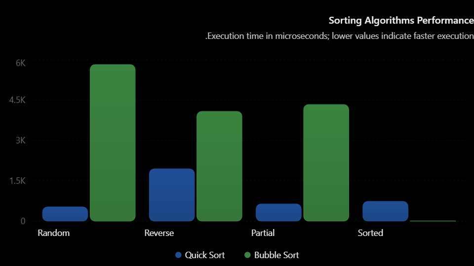

# Sorting Algorithms Benchmark

A Java project that compares the performance of Quick Sort and Bubble Sort using four different input-array cases.

## Student Information

- **Student Name:** [احمد صلاح الدين القلالي]
- **University ID:** [3167062]
- **Section Number:** [C]

## Project Description

This project benchmarks two sorting algorithms using Java:

1. Quick Sort
2. Bubble Sort

The program measures execution time in microseconds and checks whether each algorithm successfully sorts the array.

## Test Cases

The program tests each algorithm using four different arrays:

- **Random:** An array containing randomly generated integers.
- **Reverse:** An array arranged in descending order.
- **Partial:** An initially sorted array modified by random swaps.
- **Sorted:** An array arranged in ascending order.

## Configuration

| Parameter | Value |
|---|---|
| Programming Language | Java |
| Array Size | 100,000 elements |
| Number of Algorithms | 2 |
| Number of Test Cases | 4 |
| Total Sorting Runs | 8 |
| Timing Method | `System.nanoTime()` |
| Time Unit | Microseconds (µs) |

## Algorithm Overview

### Quick Sort

Quick Sort uses the Divide and Conquer approach. A random element from the current array segment is selected as the pivot. The partition method rearranges elements around the pivot, and recursive calls sort the remaining left and right segments.

- Average Time Complexity: `O(n log n)`
- Worst-case Time Complexity: `O(n²)`

Random pivot selection reduces the likelihood of highly unbalanced partitions, but it does not eliminate the worst-case scenario.

### Bubble Sort

Bubble Sort repeatedly compares adjacent elements and swaps them when they are in the wrong order. The implementation uses a `swapped` flag to stop early if no swaps occur during a complete pass.

- Best-case Time Complexity: `O(n)` for an already sorted array
- Average Time Complexity: `O(n²)`
- Worst-case Time Complexity: `O(n²)`

## Execution Time Results

Replace the placeholders with the actual measurements printed by the program.

| Algorithm | Random (µs) | Reverse (µs) | Partial (µs) | Sorted (µs) |
|---|---:|---:|---:|---:|
| Quick Sort | 18113 | 4763 | 4681 | 3691 |
| Bubble Sort | 14154928 | 10667568 | 4417852 | 25 |

## Results Analysis

The benchmark results show that Quick Sort outperformed Bubble Sort in three of the four test cases.

- **Random Array:** Quick Sort took 18,113 µs, while Bubble Sort took 14,154,928 µs.
- **Reverse Array:** Quick Sort took 4,763 µs, compared with 10,667,568 µs for Bubble Sort.
- **Partial Array:** Quick Sort completed in 4,681 µs, while Bubble Sort took 4,417,852 µs.
- **Sorted Array:** Quick Sort took 3,691 µs, while Bubble Sort took only 25 µs.

Quick Sort performed substantially better on random, reverse, and partially sorted arrays. Bubble Sort performed best on the already sorted array because the implementation uses a `swapped` flag to terminate early when no swaps occur.

These measurements represent a single execution and may vary between runs due to random pivot selection and system performance.

## Performance Chart

## Implementation Details

- `main()` runs the sorting experiments and records execution times.
- `createArrays()` generates the four test arrays.
- `quickSort()` performs recursive Quick Sort.
- `partition()` partitions the array using a randomly selected pivot.
- `bubbleSort()` implements Bubble Sort with early termination.
- `isSorted()` checks whether the resulting array is sorted in ascending order.
- `printResults()` displays the summary table.

Each algorithm receives an independent copy of the original array. Array copying is performed before timing begins, ensuring that the measured duration represents the sorting operation rather than the copying process.

## Conclusion

This project compares Quick Sort and Bubble Sort using four different input-array configurations.

The benchmark results show that Quick Sort performed substantially better on random, reverse, and partially sorted arrays. Bubble Sort performed best on the already sorted array because its early-termination mechanism stops the algorithm when no swaps are needed.

Random pivot selection reduces the likelihood of unbalanced partitions in Quick Sort, although its worst-case time complexity remains O(n²).

Execution times may vary depending on the input data, JVM warm-up, and system conditions. Repeated measurements would provide a more reliable performance comparison.
