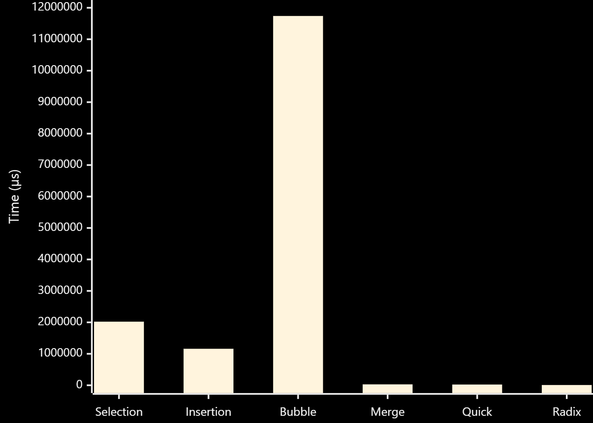
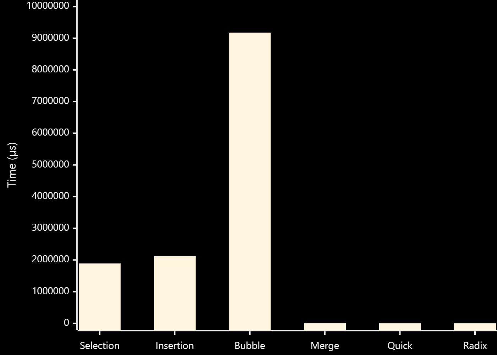
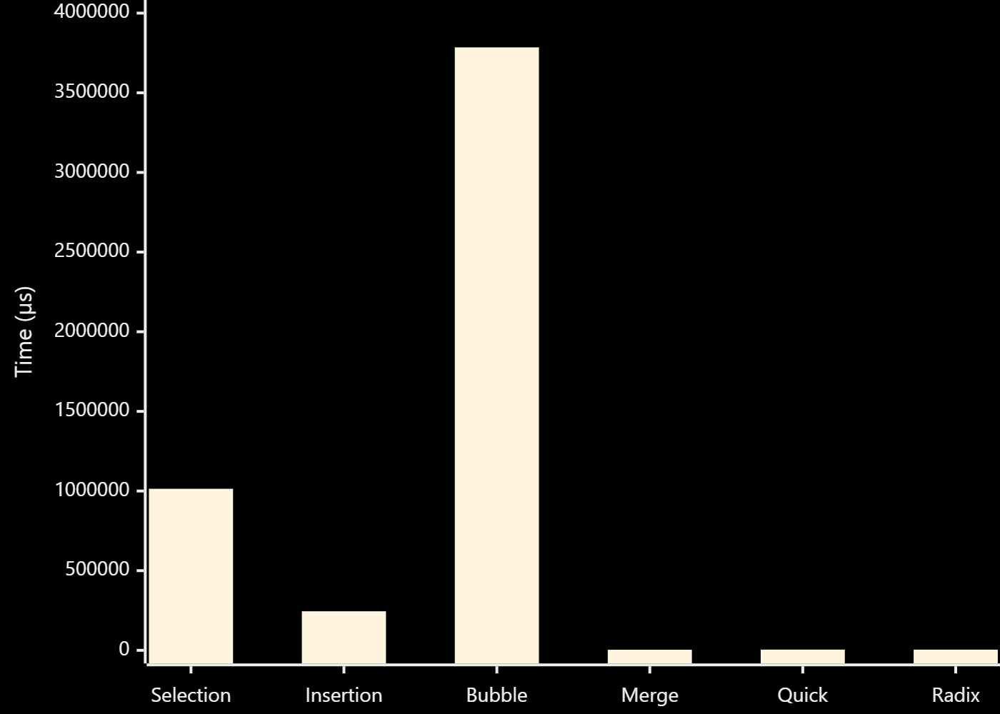
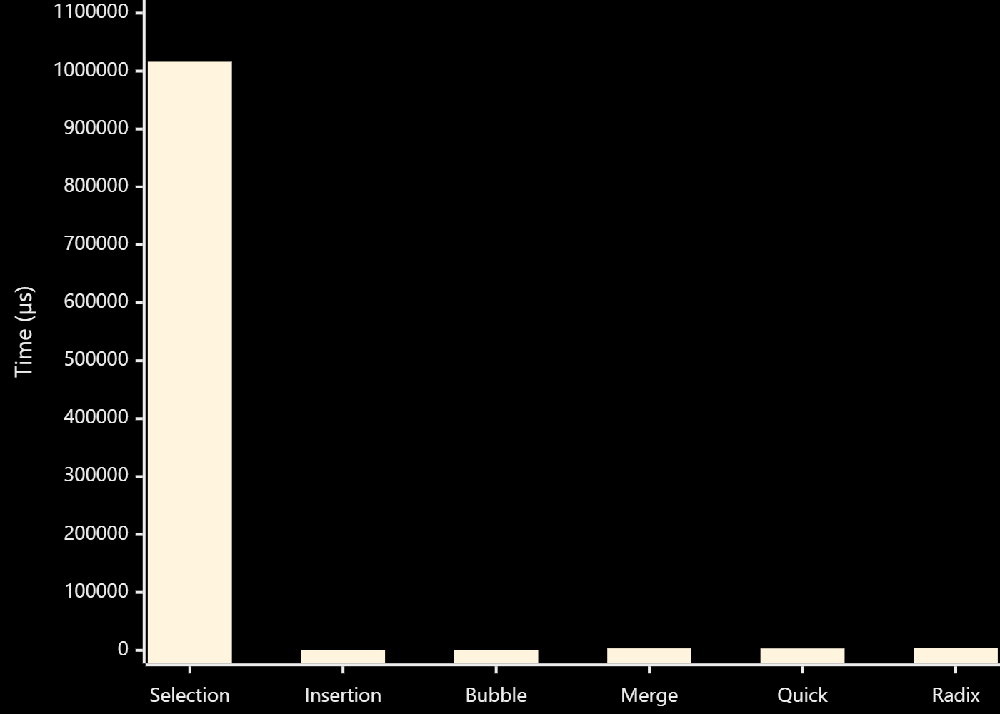

# Sorting Algorithms Benchmark

A Java project that compares the execution time of six sorting algorithms using four different input-array cases.

## Algorithms

The project implements:

1. Selection Sort
2. Insertion Sort
3. Bubble Sort
4. Merge Sort
5. Quick Sort
6. Radix Sort

## Test Setup

- **Array size:** 100,000 elements
- **Input cases:** Random, Reverse, Partial, and Sorted
- **Timing method:** `System.nanoTime()`
- **Displayed unit:** Microseconds
- **Correctness check:** `isSorted()` checks that each resulting array is in ascending order.

Each algorithm receives its own copy of the original test array so that one algorithm does not affect another algorithm's input.

### Input Cases

- **Random:** Values are generated randomly from 0 to 99,999.
- **Reverse:** Values are arranged in descending order.
- **Partial:** Starts as a sorted array and performs 10,000 random swaps.
- **Sorted:** Values are already arranged in ascending order.

## Results

The following results are the execution times from the run supplied for this benchmark. All values are in microseconds (µs).

| Algorithm | Random | Reverse | Partial | Sorted |
|---|---:|---:|---:|---:|
| Selection Sort | 2,021,892 | 1,889,398 | 1,014,017 | 1,016,096 |
| Insertion Sort | 1,160,206 | 2,129,157 | 244,998 | 58 |
| Bubble Sort | 11,739,783 | 9,177,307 | 3,785,122 | 20 |
| Merge Sort | 28,951 | 6,144 | 3,721 | 3,333 |
| Quick Sort | 23,430 | 3,221 | 4,532 | 3,177 |
| Radix Sort | 8,162 | 3,834 | 4,203 | 3,439 |

## Performance Charts

The charts below show the measured execution time for each algorithm in each input case. The vertical axis is measured in microseconds.

## Performance Charts

### Random Array

### Reverse Array

### Partially Sorted Array

### Sorted Array

## Time Complexity Comparison

| Algorithm | Best Case | Average Case | Worst Case |
|---|---|---|---|
| Selection Sort | O(n²) | O(n²) | O(n²) |
| Insertion Sort | O(n) | O(n²) | O(n²) |
| Bubble Sort | O(n) | O(n²) | O(n²) |
| Merge Sort | O(n log n) | O(n log n) | O(n log n) |
| Quick Sort | O(n log n) | O(n log n) | O(n²) |
| Radix Sort | O(d(n + k)) | O(d(n + k)) | O(d(n + k)) |

For Radix Sort, `d` is the number of digits and `k` is the digit base (10 in this implementation). The implementation sorts non-negative integers.

## Discussion

The results show a clear difference between the algorithms with quadratic time complexity, O(n²), and the more efficient algorithms for large arrays.

- **Selection Sort** takes around one to two seconds in these tests. Its execution time remains high because it performs a quadratic number of comparisons, even when the array is already sorted.
- **Insertion Sort** performs very well on the sorted array (58 µs), because it only needs to check each element once when the input is already in order. Its performance becomes much slower on reverse and random arrays.
- **Bubble Sort** is the slowest on the random, reverse, and partially sorted inputs. Its early-stop check makes it very fast on the already sorted array (20 µs).
- **Merge Sort** gives consistent results because its time complexity is O(n log n), regardless of the initial order of the input.
- **Quick Sort** is also fast in these tests. Its average time complexity is O(n log n), although its worst case is O(n²).
- **Radix Sort** is fast because it sorts values digit by digit instead of comparing every pair of elements.

In general, the measured results show that Merge Sort, Quick Sort, and Radix Sort are much more suitable for large arrays than the O(n²) algorithms. Insertion Sort and Bubble Sort can still perform well when the input is already sorted or nearly sorted.

## Conclusion

For an array of 100,000 elements, the measured results show that the choice of sorting algorithm has a major effect on execution time. Radix Sort was the fastest for the random array, while Quick Sort was the fastest for the reverse and partially sorted arrays. Bubble Sort was the fastest for the already sorted array, closely followed by Insertion Sort.

These results also demonstrate that input order can strongly affect algorithms such as Insertion Sort and Bubble Sort, while Merge Sort, Quick Sort, and Radix Sort provide much better performance on large inputs in these tests.

## Notes

- Execution times can change between runs because of system load, JVM optimization, and randomly generated input values.
- The measurements are from one run and are not an average of multiple runs.
- The benchmark measures the sorting method itself; copying the test array and checking whether it is sorted are outside the timed section.
